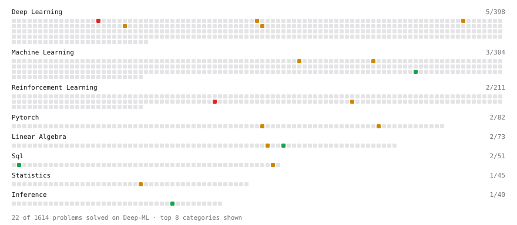

# Deep-ML

My machine learning practice from [Deep-ML](https://www.deep-ml.com). Every solution here was written by hand.

**25** solved · 25 problems · 0 labs · 0 math

[**Browse the interactive portfolio**](https://lanceyliao.github.io/deep-ml/) to replay this filling in over time.

## Problems

| | Difficulty | Solved | |
| --- | --- | --- | --- |
| [Balance Dataset via Undersampling](https://www.deep-ml.com/problems/1057) | easy | 2026-10-14 | [solution](problems/1057-balance-dataset-via-undersampling) |
| [Random Rotation Matrix and a Rotation Layer](https://www.deep-ml.com/problems/1190) | easy | 2026-10-05 | [solution](problems/1190-random-rotation-matrix-and-a-rotation-layer) |
| [RL Training GPU Utilization Tracker](https://www.deep-ml.com/problems/678) | easy | 2026-10-24 | [solution](problems/0678-rl-training-gpu-utilization-tracker) |
| [Select specific columns](https://www.deep-ml.com/problems/1102) | easy | 2026-10-15 | [solution](problems/1102-select-specific-columns) |
| [Streaming ASR Latency Budget: Chunk Size, Real-Time Factor and Round Trip](https://www.deep-ml.com/problems/1442) | easy | 2026-10-20 | [solution](problems/1442-streaming-asr-latency-budget-chunk-size-real-time-factor-and-round-trip) |
| [Tinygrad: Implement Dropout from Scratch](https://www.deep-ml.com/problems/922) | easy | 2026-10-13 | [solution](problems/0922-tinygrad-implement-dropout-from-scratch) |
| [Analyze Singular Value Spectrum to Determine Intrinsic Rank](https://www.deep-ml.com/problems/876) | medium | 2026-10-03 | [solution](problems/0876-analyze-singular-value-spectrum-to-determine-intrinsic-rank) |
| [Anchor Matching via IoU Assignment](https://www.deep-ml.com/problems/1253) | medium | 2026-10-02 | [solution](problems/1253-anchor-matching-via-iou-assignment) |
| [Calculate AUC (Area Under ROC Curve)](https://www.deep-ml.com/problems/277) | medium | 2026-10-09 | [solution](problems/0277-calculate-auc-area-under-roc-curve) |
| [Compute-Matched Looped MoE Configuration (SMELT)](https://www.deep-ml.com/problems/1394) | medium | 2026-10-11 | [solution](problems/1394-compute-matched-looped-moe-configuration-smelt) |
| [Diffusion Model U-Net Time Embedding](https://www.deep-ml.com/problems/399) | medium | 2026-09-26 | [solution](problems/0399-diffusion-model-u-net-time-embedding) |
| [Dropout Layer](https://www.deep-ml.com/problems/151) | medium | 2026-09-28 | [solution](problems/0151-dropout-layer) |
| [Forward Diffusion Process](https://www.deep-ml.com/problems/303) | medium | 2026-09-25 | [solution](problems/0303-forward-diffusion-process) |
| [Guidance Attention Mask for Chunked Video](https://www.deep-ml.com/problems/461) | medium | 2026-10-16 | [solution](problems/0461-guidance-attention-mask-for-chunked-video) |
| [Implement the Huber Loss Function](https://www.deep-ml.com/problems/192) | medium | 2026-10-19 | [solution](problems/0192-implement-the-huber-loss-function) |
| [Poisson Deviance and Overdispersion](https://www.deep-ml.com/problems/1367) | medium | 2026-09-29 | [solution](problems/1367-poisson-deviance-and-overdispersion) |
| [Power Users With Purchases in Every Month of the Year](https://www.deep-ml.com/problems/1462) | medium | 2026-10-06 | [solution](problems/1462-power-users-with-purchases-in-every-month-of-the-year) |
| [Queue from Two Stacks and a Min-Stack](https://www.deep-ml.com/problems/1147) | medium | 2026-10-08 | [solution](problems/1147-queue-from-two-stacks-and-a-min-stack) |
| [Random Walk: TD vs Monte Carlo](https://www.deep-ml.com/problems/514) | medium | 2026-10-21 | [solution](problems/0514-random-walk-td-vs-monte-carlo) |
| [Resource Dilation Factor for Scheduling](https://www.deep-ml.com/problems/623) | medium | 2026-10-04 | [solution](problems/0623-resource-dilation-factor-for-scheduling) |
| [SGD with Momentum Step](https://www.deep-ml.com/problems/1235) | medium | 2026-10-01 | [solution](problems/1235-sgd-with-momentum-step) |
| [Zero-Copy Batch Data Loading from Shared Memory](https://www.deep-ml.com/problems/659) | medium | 2026-10-10 | [solution](problems/0659-zero-copy-batch-data-loading-from-shared-memory) |
| [Positional Encoding Calculator](https://www.deep-ml.com/problems/85) | hard | 2026-10-12 | [solution](problems/0085-positional-encoding-calculator) |
| [Successor Representation Learning](https://www.deep-ml.com/problems/597) | hard | 2026-09-30 | [solution](problems/0597-successor-representation-learning) |
| [Two-Sample T-Test Implementation](https://www.deep-ml.com/problems/211) | hard | 2026-10-22 | [solution](problems/0211-two-sample-t-test-implementation) |

---

_This file is regenerated by Deep-ML on every push._
